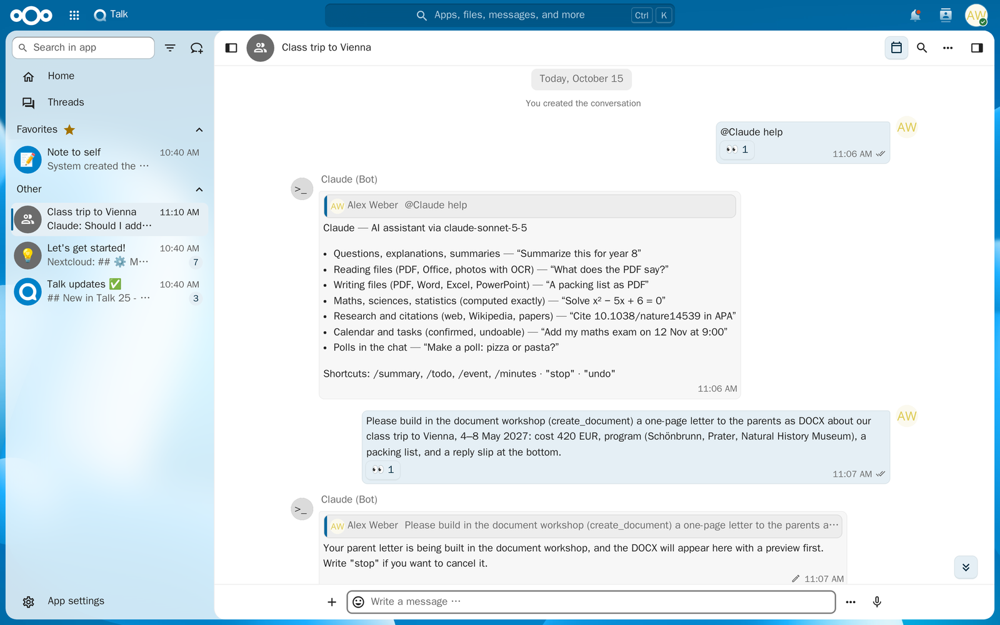
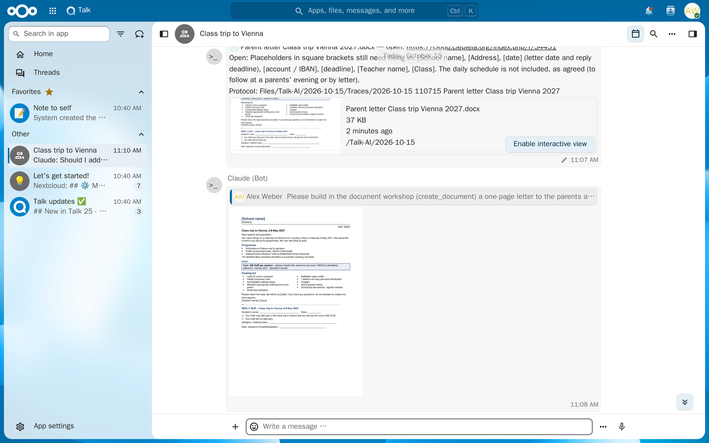
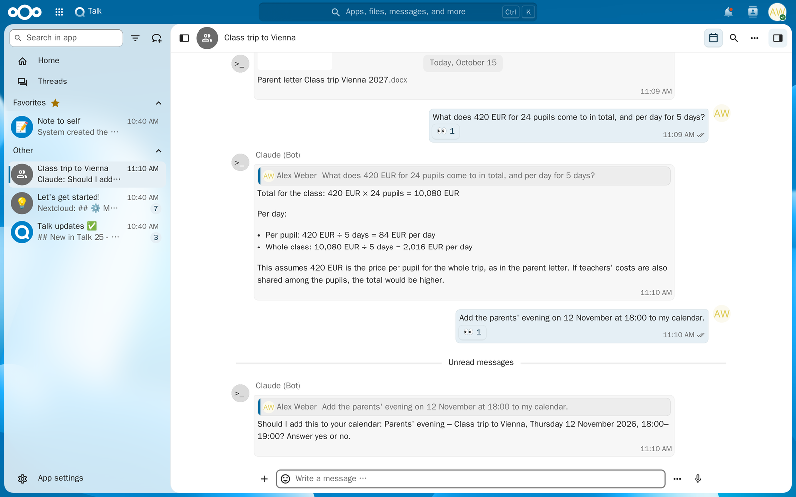
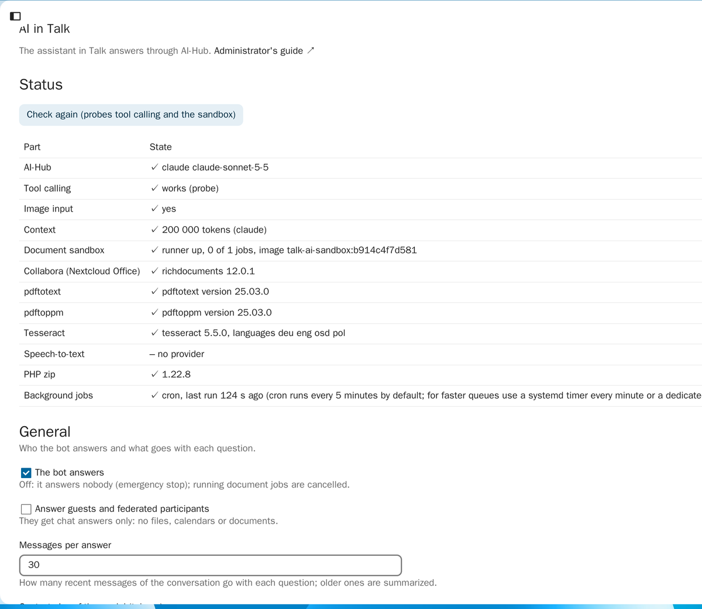

# AI in Talk

A bot for [Nextcloud Talk](https://apps.nextcloud.com/apps/spreed) that answers with AI: an
assistant for work and school in your conversations. It reads the files you share, writes
documents, slides, spreadsheets and flash cards, does maths and cites sources.

- **Reads what you share:** Word, Excel (every sheet), PowerPoint (with speaker notes),
  OpenDocument, old `.doc`/`.xls`/`.ppt`, PDF, Markdown, CSV and text, and images. Text in photos
  and scanned PDFs is read with OCR. It also finds your files by name, reads web pages, and
  reads further back in the conversation (summaries, minutes).
- **Writes files into the chat:** PDF, Word, Excel (with formulas), PowerPoint (with speaker
  notes), OpenDocument, Markdown, CSV, HTML, `.ics`, `.bib` and source code.
- **Designed documents:** themes (modern, classic, academic with numbered headings, minimal,
  playful), cover pages, a table of contents, page numbers, footnotes, callout boxes (note,
  tip, warning, definition, theorem, example …), striped tables, columns, LaTeX formulas,
  highlighted code (Python, Java, SQL, pseudocode …), and charts and images embedded in
  documents, slides and chat answers.
- **Designed presentations:** 15 slide layouts (stats, steps, timeline, comparison, cards,
  quote, full-bleed photo, image beside text, chart, table …), an agenda, section slides,
  slide numbers, and themes with gradients, decorations and font pairings (modern, dark,
  gradient, bold, nature, elegant, playful, classic, academic, minimal, accessible), or a
  design of the bot's own. Photos come from Wikimedia Commons with their attribution.
- **Researches by default:** documents, presentations and factual answers build on a web
  search, Wikipedia and scholarly papers, with the sources named.
- **Learning:** summaries, quizzes, and flash cards, to print (question and answer side by side,
  to fold) or to import into Anki or Quizlet.
- **Maths:** solves step by step and calculates exactly (a calculator tool, not the model's
  guess), with statistics and linear regression. Formulas in LaTeX become real formulas in
  documents and readable Unicode in the chat (x², √, ∑). Graphs of functions and line, bar,
  scatter and pie charts arrive as images.
- **Sources:** searches the web, looks things up in Wikipedia and finds scholarly papers
  (OpenAlex), and cites by DOI, ISBN or URL in APA, MLA, Chicago, Harvard, IEEE, Vancouver,
  DIN 1505-2, ISO 690 or any CSL style, also as BibTeX or RIS.
- **Subjects, computed rather than guessed:** maths (curve sketching: zeros, extrema,
  inflection points, integrals; linear systems, matrices, vectors, lines and planes, exact with
  fractions), chemistry (molar masses, balancing equations, elements), physics (units and
  constants), biology (crosses with Punnett squares, DNA to protein), statistics (probability
  distributions, t- and χ² tests), geography (places, distances, climate diagrams), music
  (scales, chords, intervals, transposition), economics (interest, loans with repayment
  schedules, break-even), physical education (heart-rate zones, pace, race times, BMI,
  calories), informatics (truth tables, encodings, SQL on example tables), history (timelines),
  and mind maps for any topic.
- **Exams, by the official rules:** syllabus, operators, dates and grading tables come from the
  official documents you share or name (read like any file or page), not from built-in data
  for one state or year. Then it computes: marks to points or grades by your table (the German
  15-point table by default), an error index and its deduction or scale, grades from weighted
  parts, written and oral exams combined, the Abitur's total and average (KMK formulas) and
  what a target grade needs; checks that a practice exam adds up and balances its
  requirement levels; and makes a study plan to the exam dates.
- **Studies:** university averages by the rule of your Prüfungsordnung (ECTS, cut or rounded,
  best-of, double weight), the grade still needed, foreign grades (bayerische Formel), law
  exam points; measurement uncertainty for lab reports (GUM: propagation, budget, rounding,
  weighted fits); numerics with tables (Newton, bisection, Simpson, Runge-Kutta, eigenvalues);
  more tests (binomial test with rejection region, ANOVA, Mann-Whitney, Wilcoxon,
  Kruskal-Wallis, Spearman, confidence intervals, effect sizes, APA lines); chemistry pH,
  titration curves and equilibria; register machines, automata and regular expressions;
  legal deadlines by §§ 187–193 BGB with each state's holidays, and federal norms.
- **Formulas as images:** with the sandbox, LaTeX that the chat's Unicode cannot show (nested
  fractions, matrices, integrals with limits, aligned derivations) is typeset by ziamath and
  sent as an image; documents built in the sandbox use it too.
- **Images drawn with code:** with the sandbox, diagrams and flowcharts (Graphviz), posters,
  invitations, icons and flat illustrations (SVG), function graphs and geometry (matplotlib),
  and changes to a shared photo (crop, label, collage) as PNG, SVG, WebP or JPEG; the AI looks
  at each render and corrects it. No photos and no likeness of real people: it draws, it does
  not generate pictures.
- **Art:** the palette of a painting or photo, colour harmonies, colour names (pigments too),
  value studies (grayscale, notan), composition grids (thirds, golden ratio), mirrored and
  blurred views, and help with exhibition texts and statements.
- **Planning:** reads and adds events and tasks in your calendar, with reminders and repeats
  (exams, deadlines, exhibitions, a timetable, a study plan), and turns dates from a PDF, a
  letter or a photo of a timetable into an `.ics` file to import anywhere.
- **Writing:** feedback as a document with marked corrections (deleted, inserted, highlighted).
- **Uses your rights:** the bot sees only what the asking person may see, and the files it sends
  are saved in their folder for the conversation.

It answers through [AI-Hub](https://apps.nextcloud.com/apps/ai_hub), your server's connection to
an AI (Claude, Gemini, OpenAI-compatible, or their command line tools), and is named after it:
*Claude*, *Gemini*, *ChatGPT*, …

## Screenshots

| | |
|---|---|
|  |  |
|  |  |

## Requirements

- Nextcloud 32 to 36, with Talk 25 or later and AI-Hub set up (Admin settings → AI-Hub).
- For Word, Excel, PowerPoint and PDF files it writes, for charts, and to read old Office files:
  Nextcloud Office (Collabora). Without it, it sends OpenDocument files and SVG charts.
- To read PDFs, `pdftotext`; for scanned PDFs also `pdftoppm` (Poppler,
  `apt install poppler-utils`).
- For OCR, Tesseract with the languages you need (`apt install tesseract-ocr tesseract-ocr-deu`).
- PHP with the `zip` extension. The web (links, citations) is reached through Nextcloud's HTTP
  client.
- Optional, for documents built with code (below): Docker or Podman on the server, ideally
  rootless, and Python 3 for the runner.

## Installing

1. Install **AI in Talk** from the app store (*Apps*, *Social & communication*). Or unpack a
   release's `talk_ai-X.Y.Z.tar.gz` into `custom_apps/` and run `occ app:enable talk_ai`.
   This installs the bot in Talk.
2. In a conversation, open the conversation settings, then *Bots*, and enable the bot.

The bot takes the name of the AI that answers, as AI-Hub is set up for this app, and is renamed
when that changes (within ten minutes, or at its next answer). For a fixed name:
`occ config:app:set talk_ai name --value Assistant`.

### The document sandbox (optional)

For demanding office files and images the bot can hand the work to a sandbox: the AI writes
code (python-docx, openpyxl, python-pptx; docx, exceljs, pptxgenjs; SVG, Pillow, Graphviz,
matplotlib), builds the file, renders it with LibreOffice (an image with rsvg-convert or
ImageMagick), looks at the pages and corrects it, then delivers it. Each job runs in its
own container: no network, read-only, non-root, without capabilities, limited in CPU, memory,
processes and time, writable only `/work` (in memory); it is removed afterwards.

1. Build the image: `docker build -t talk-ai-sandbox:latest sandbox/`.
2. Copy `skills/` (read-only for all) and `sandbox/runner.py` to the server, write a random
   token to a file readable only by the runner's user, and run the runner as a service with
   `RUNNER_SOCKET`, `RUNNER_TOKEN_FILE`, `RUNNER_IMAGE`, `RUNNER_SKILLS` and the limits
   (`RUNNER_MAX_JOBS`, `RUNNER_CPUS`, `RUNNER_MEMORY_MB`, `RUNNER_DISK_MB`,
   `RUNNER_MAX_SECONDS`, `RUNNER_EXEC_IDLE`; see the file's header).
3. Make the socket reachable from Nextcloud (a bind mount for containers) and tell the app:
   `occ config:app:set talk_ai sandbox_socket --value /run/talk-ai-sandbox/runner.sock` and
   `occ config:app:set talk_ai sandbox_token --value … --lazy --sensitive`.

Settings: `document_groups` (a JSON list of groups that may use it; empty: everyone),
`document_max_tools` (60), `document_max_seconds` (0: no limit), `document_corrections` (3),
`document_folder` (`Talk-AI`). The AI connection must call tools; one that
does not is refused. Without the sandbox, the bot writes documents itself as before.

Nothing in a job is cut off by the clock: a command in the sandbox runs as long as it
makes progress (output or CPU time) and is stopped when it has neither for two minutes
(`RUNNER_EXEC_IDLE`); the job beats while it waits, shows the command's last line in its
status message, and "stop" ends the command at once. A job ends when it is done, has used
its tool calls, or stops making progress; `document_max_seconds` adds a limit in all.

## Using it

- **In a conversation with only you,** the bot answers every message.
- **With more people,** it answers when you name it (`@Claude what does this say?`, or
  `Claude, …` at the start) or reply to one of its messages.
- It reacts with 👀 at once, then answers in a few seconds to a minute.

For example:

- Share a PDF and ask "@Claude summarize this for year 9".
- "Make 20 flash cards about the French Revolution for Anki."
- "Turn my notes into a presentation" (after sharing them), "as PowerPoint".
- "Solve x² − 5x + 6 = 0 step by step and plot it."
- "A budget for the class trip as an Excel file."
- "Cite 10.1038/nature14539 in APA and as BibTeX."
- "Balance KMnO4 + HCl → KCl + MnCl2 + H2O + Cl2."
- Share a painting and ask "@Claude what is its palette, and what would complement it?"
- "Put my maths exam on 12 November at 9:00 in my calendar, with a reminder the day before."
- "A mind map of the causes of the First World War."
- Share the official syllabus and ask "a mock exam for maths with a marking scheme", "I got 57
  of 80 marks: how many points?", "my course points so far: what average, and what do I need
  for 1.5?"
- "My grades with ECTS: what is my average under my PO (one decimal, cut off)?"
- "Pendulum: l = 1.000 ± 0.002 m, T = 2.006 ± 0.005 s: g with its uncertainty."
- "A one-month deadline from 31 January, in Hesse: when does it end?"
- Share a photo of the school timetable and ask "make it an .ics file, weekly until the summer
  holidays".
- "Curve sketching of f(x) = x³ − 3x" or "solve 2x + y − z = 8, −3x − y + 2z = −11, −2x + y + 2z = −3".
- Share a painting and ask for "a value study in three tones and the thirds grid".
- Share a photo of the blackboard and ask "@Claude what does it say?"
- With the sandbox: share a `.ott` template and notes and ask for "the meeting minutes on this
  template as .docx"; share a CSV and ask for "an Excel file with monthly sums as formulas and
  a chart"; share a report and ask "add a chapter on costs after chapter 2"; ask for "a
  flowchart of how we order supplies as PNG" or "an invitation to the summer party, A5".

## How it works

The app (`app/talk_ai/`) is PHP, with no build step.

- **Receiving:** Talk calls the bot in-process (`BotInvokeEvent`, an app bot). The listener
  (`lib/Listener/BotInvokeListener.php`) only decides whether to answer and reacts 👀. It hands
  the question to the app's process route as a request signed with the bot's secret, and doesn't
  wait. When that fails, a background job answers instead.
- **Answering:** `lib/Service/Reply.php` reads the conversation's recent messages through Talk's
  message parser, as the asking person sees them. It then asks the AI layer (`lib/Ai/Hub.php`),
  scenario `chat`, with web search and tools that run in PHP with that person's rights:
    - files: `list_files`, `read_file` (`lib/Document/TextExtractor.php`; old formats converted
      by Collabora, OCR by Tesseract), `find_files`;
    - writing: `send_file` (`lib/Document/OdtWriter.php`, `OdsWriter.php`, `OdpWriter.php`,
      converted to Word, Excel, PowerPoint or PDF by Nextcloud's file conversion) and
      `send_flashcards`;
    - maths: `calculate` (`Calculator.php`, a parser, no code is run), `statistics`, `plot`
      (`Chart.php`, SVG rendered to PNG by Collabora); LaTeX formulas become MathML formula
      objects in documents and Unicode in the chat (`Math.php`);
    - subjects: `convert_units` (`Units.php`), `chemistry` (`Chemistry.php`, balancing by the
      exact null space), `biology`, `sport`, `informatics` (SQL in an in-memory SQLite without
      files or recursion), `colors` (palettes by Imagick);
    - more subjects: `analyze_function` (`Analysis.php`), `linear_algebra` (`LinearAlgebra.php`,
      fractions throughout), `music`, `finance`, `geo` (OpenStreetMap's Nominatim), and
      `image_study` (Imagick);
    - planning: `calendar` (`lib/Service/Calendar.php`, through Nextcloud's calendar API, and
      `.ics` files with the time zone's definition, `lib/Document/Ics.php`);
    - context and the web: `read_chat`, `read_url`, `lookup` and `cite` (`lib/Service/Web.php`;
      Wikipedia, OpenAlex; DOIs are formatted by doi.org, books come from Open Library).
- **Posting:** the bot's messages and files are posted as the bot, as Talk's bot API does. A
  file is saved in the person's folder for the conversation and sent as Talk's file message,
  as Talk 25's attachments are. If that folder doesn't exist yet, it's created and shared like
  for a first attachment, without Talk's "shared a folder" message.
- **Documents in the sandbox:** `create_document` hands a job to the process route's sibling
  `/document`. `lib/Service/DocumentJob.php` runs it: the model works with `bash`, `read_file`,
  `write_file`, `edit_file`, `list_files`, `render_document`, `deliver_file` and `finish` in its
  container (`lib/Service/Sandbox.php` talks to `sandbox/runner.py`), in one run of the AI
  layer's loop (`lib/Ai/Loop.php`) until `finish` or a limit. Rendered pages (a contact sheet
  and single pages) go to the model as images with the render's result. A status message follows the phases; only the result
  stays: the steps are kept nowhere (no protocol, no page images), and the previews' messages
  and files are removed when the job ends (protocols of earlier versions are removed by
  `lib/BackgroundJob/CleanTraces.php`). The skills (`skills/<format>/SKILL.md` and scripts)
  tell the model how to build each format.
- **Name:** `lib/Service/Bot.php` installs the bot and renames it (Talk updates a bot installed
  again with the same address and secret) when the AI or the setting changes.

## Documentation

- [Administrator's guide](docs/admin.md): requirements, the sandbox, settings, privacy, evaluating a model.
- [Short guides for users](docs/user.md) (English, Deutsch, Polski).
- [Developer's guide](docs/developer.md): layout, the document job's tools, skills, tests.
- [Changelog](CHANGELOG.md).

## Developing

```bash
composer install && vendor/bin/phpunit
docker build -t talk-ai-sandbox:test sandbox/ && tests/golden/run.sh talk-ai-sandbox:test
python3 tests/compat/talk_api.py
```

The tests need neither Nextcloud nor network. CI lints the PHP, checks `appinfo/info.xml`
against the app store's schema and runs the tests. A tag `vX.Y.Z` with the same version in
`appinfo/info.xml` is released by `.forgejo/workflows/release.yml`, signed and published on the
app store, given the secrets `APP_SIGNING_KEY` and `APPSTORE_TOKEN`.

## Reporting problems

Open an issue on GitHub:
[sarumaj/nextcloud-talk-ai](https://github.com/sarumaj/nextcloud-talk-ai/issues).

## Licence

[AGPL-3.0-or-later](LICENSE).
